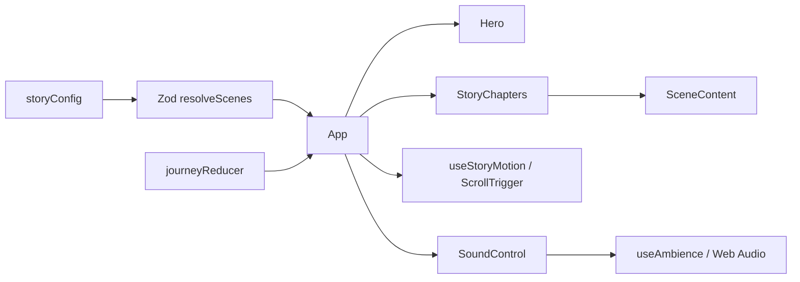

# Arsitektur

## Stack

- React untuk UI dan state lokal.
- TypeScript untuk tipe dan build check.
- Vite untuk development server dan static build.
- Zod untuk memeriksa konfigurasi scene saat runtime.
- GSAP + ScrollTrigger untuk transition/entrance dan parallax.
- Web Audio API untuk ambience procedural; tidak ada file audio yang diunduh.
- Oxlint dan Node.js test runner untuk lint serta unit test.
- Playwright Test untuk E2E Chromium pada alur pembaca utama.
- GitHub Actions untuk CI pada pull request dan push `main`; Vercel menyajikan static build dari `dist/`.

`motion` tercantum sebagai dependency project, tetapi pengalaman saat ini memakai GSAP untuk motion.

## Struktur source

```text
src/
├── App.tsx                    # Orkestrasi view, state, dan navigasi utama
├── App.css                    # Komponen dan gaya dasar pengalaman
├── index.css                  # Reset, token tema, focus, dan reduced-motion CSS
├── scroll-story.css           # Layout chapter scroll, art direction, dan dekorasi
├── content/story.ts           # Konten, schema Zod, dan fallback scenes
├── lib/journey.ts             # Reducer journey dan penentuan scene yang tersedia
├── components/
│   ├── SceneContent.tsx       # Render heading, copy, fragment, confession, closing
│   ├── StoryChapters.tsx      # Render section cerita dan Final Click
│   ├── SectionDecor.tsx       # Motif visual SVG per jenis scene
│   ├── Orbit.tsx              # SVG atmosfer latar
│   ├── SoundControl.tsx       # Kontrol audio pengunjung
│   ├── Arrow.tsx              # Ikon panah dekoratif/arah
│   └── ExperienceBoundary.tsx # Fallback jika React tree melempar error
└── hooks/
    ├── useStoryMotion.ts      # GSAP timeline dan ScrollTrigger lifecycle
    ├── useReducedMotion.ts    # Preferensi reduced motion dari sistem
    └── useAmbience.ts         # Audio graph, volume, suspend, dan cleanup
```

Automated journey checks berada di `tests/journey.test.mjs` dan browser E2E berada di `e2e/confession.spec.ts`. Konfigurasi Playwright menjalankan Vite preview atas hasil production build dan menaruh diagnostics di `.cache/playwright/`.

## Aliran data



## Model konten

Setiap scene memiliki `id`, `type`, `label`, `heading`, dan optional `emphasis`.

| `type` | Konten khusus | Peran |
| --- | --- | --- |
| `invitation` | `body` | Hero pembuka dan aksi Begin. Harus menjadi scene pertama. |
| `narrative` | `layout`, `fragments[]` | Chapter story biasa; satu fragmen adalah unit copy, bukan gerbang klik pada alur sekarang. |
| `confession` | `introduction`, `confession`, `supporting` | Gerbang Final Click yang mengontrol apakah copy utama dirender dan apakah closing dapat diakses. |
| `closing` | `body` | Penutup tanpa permintaan balasan; harus menjadi scene terakhir. |

`resolveScenes` mem-parsing kandidat dengan Zod, melewati scene opsional yang invalid/ID duplikat, kemudian memastikan tepat satu invitation di awal, satu confession sebelum akhir, dan satu closing di akhir. Jika peran utama tidak valid, ia menggunakan fallback aman tiga scene. Ini menangani data runtime; kesalahan sintaks TypeScript tetap harus diperbaiki agar proyek dapat dikompilasi.

## State dan navigasi

`JourneyState` hanya memiliki `started` dan `confessionRevealed`.

- Awal/refresh: `{ started: false, confessionRevealed: false }`.
- **Begin:** membuka view story tanpa membuka confession.
- Scroll native/anchor: mengubah posisi baca; tidak memodifikasi gate.
- **Reveal:** hanya berlaku setelah story dimulai; membuka confession dan membuat closing tersedia.
- Wordmark: kembali ke opening sambil mempertahankan reveal pada kunjungan React yang sama.
- **Read again:** mereset dua nilai state.

Tidak ada router, server API, database, storage persisten, atau sinkronisasi lintas perangkat. Browser hash digunakan untuk anchor chapter.

## Error dan fallback

- Fallback konfigurasi di `resolveScenes` mempertahankan invitation/confession/closing jika data esensial tidak valid.
- `ExperienceBoundary` mengganti subtree UI dengan halaman sederhana dan tombol **Try again** bila terjadi error render React.
- Audio yang tidak tersedia tidak memblokir story.
- Situs memerlukan JavaScript; `index.html` menyediakan keterangan `noscript`.
